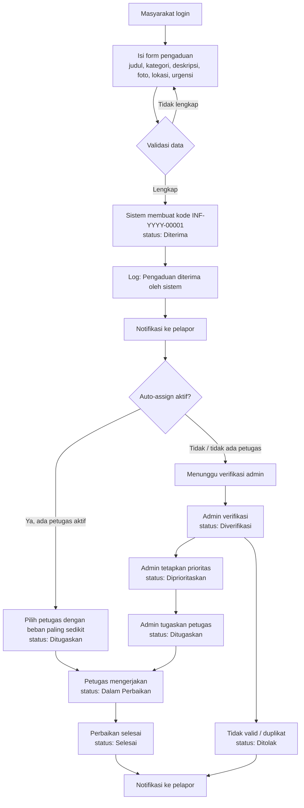

# Alur Proses Pengaduan INFRA-CARE

Dokumen ini menjelaskan alur penanganan pengaduan dari sisi masyarakat, admin, petugas, dan sistem. Isinya mengikuti implementasi di `backend/server.js` dan `frontend/src/App.jsx`.

## 1. Aktor dan Tanggung Jawab

| Aktor | Peran di sistem | Yang bisa dilakukan |
| --- | --- | --- |
| Masyarakat | Pelapor | Daftar/login, membuat pengaduan, memantau tracking, melihat riwayat, menerima notifikasi, mengubah profil |
| Admin Pemerintah | Pengelola | Melihat semua pengaduan, memverifikasi, memprioritaskan, menugaskan/menlepas petugas, mengubah status, menghapus pengaduan, mengelola pengguna, melihat laporan, mengatur SLA dan auto-assign |
| Petugas Lapangan | Pelaksana | Melihat daftar pengaduan, mengambil pengaduan yang belum ditugaskan, mengubah status pengaduan miliknya, melihat peta dan laporan |
| Sistem | Otomatis | Membuat nomor pengaduan, mencatat log status, mengirim notifikasi, menghitung statistik/SLA, auto-assign bila diaktifkan |

## 2. Status Pengaduan

| Status | Arti | Posisi di timeline |
| --- | --- | --- |
| `Diterima` | Laporan masuk dan tercatat di sistem | 1 |
| `Diverifikasi` | Laporan sudah dicek kebenarannya oleh admin | 2 |
| `Diprioritaskan` | Laporan ditetapkan prioritas penanganannya | 3 |
| `Ditugaskan` | Laporan sudah diberikan kepada petugas | 4 |
| `Dalam Perbaikan` | Petugas sedang mengerjakan perbaikan | 5 |
| `Selesai` | Perbaikan selesai | 6 |
| `Ditolak` | Laporan tidak dilanjutkan (mis. tidak valid/duplikat) | Cabang akhir |

Status `Selesai` dan `Ditolak` adalah status akhir. `Ditolak` ditampilkan terpisah dari timeline, disertai catatan alasan penolakan.

## 3. Diagram Alur Utama



Alur tanpa auto-assign (default):

```
Diterima → Diverifikasi → Diprioritaskan → Ditugaskan → Dalam Perbaikan → Selesai
                                                                    └→ Ditolak (dari tahap mana pun)
```

## 4. Rincian Tahap

### Tahap 0 — Registrasi dan Login

1. Masyarakat membuka `/login`, memilih daftar, lalu mengisi nama, email, dan password (minimal 6 karakter).
2. `POST /api/auth/register` selalu membuat akun dengan peran `masyarakat`; peran lain hanya bisa dibuat admin.
3. Login memakai `POST /api/auth/login`; password dicek dengan bcrypt.
4. Jika akun dinonaktifkan (`aktif = false`), login ditolak dengan pesan "Akun Anda dinonaktifkan".
5. Sistem mengembalikan JWT berlaku 7 hari tanpa data foto (agar header tidak membengkak).

### Tahap 1 — Membuat Pengaduan

Pelaku: **Masyarakat** (`POST /api/complaints`, wajib login).

Data wajib:

- Judul
- Kategori: `Jalan`, `Jembatan`, `Drainase`, `Penerangan`, `Fasilitas Umum`, `Lainnya`
- Deskripsi (maks. 500 karakter di form)
- Foto bukti (JPG/PNG, maks. 5 MB; dikompres di browser menjadi JPEG sisi maks. 1280 px)
- Lokasi (dipilih dari peta OpenStreetMap atau hasil pencarian alamat; menyimpan `lat`/`lng`)
- Urgensi: `Tinggi`, `Sedang`, `Rendah`

Yang dilakukan sistem:

1. Memvalidasi kelengkapan; jika kurang, balas `400` dengan pesan spesifik.
2. Mengambil nomor urut dari sequence `complaint_seq`, lalu membentuk kode `INF-<tahun>-<5 digit>`.
3. Menyimpan pengaduan dengan status awal `Diterima`.
4. Menulis log pertama: status `Diterima`, catatan "Pengaduan diterima oleh sistem".
5. Menjalankan auto-assign bila setting `auto_assign = 'true'`:
   - Memilih petugas aktif dengan jumlah tugas aktif (`Ditugaskan` + `Dalam Perbaikan`) paling sedikit.
   - Bila ada: status berubah menjadi `Ditugaskan`, petugas menerima notifikasi "Tugas Baru", dan log mencatat "Otomatis ditugaskan kepada <nama>".
   - Bila tidak ada petugas aktif: pengaduan tetap `Diterima`.
6. Mengirim notifikasi "Pengaduan Diterima" ke pelapor.
7. Mengembalikan data pengaduan; frontend menampilkan halaman sukses berisi nomor pengaduan.

Catatan: jika auto-assign aktif, tahap `Diverifikasi` dan `Diprioritaskan` bisa terlewati karena status langsung `Ditugaskan`. Ini perilaku yang disengaja.

### Tahap 2 — Verifikasi (Admin)

Pelaku: **Admin**.

1. Admin membuka menu **Kelola Pengaduan**.
2. Admin memeriksa foto, deskripsi, lokasi, dan urgensi.
3. Admin mengubah status menjadi `Diverifikasi` melalui dropdown status.
4. `PATCH /api/complaints/:id/status` menyimpan status baru, menulis log, dan mengirim notifikasi ke pelapor.

Jika laporan tidak valid, admin dapat langsung memilih `Ditolak` (lihat Tahap 7).

### Tahap 3 — Penetapan Prioritas (Admin)

1. Admin menilai tingkat urgensi dan dampak.
2. Status diubah menjadi `Diprioritaskan`.
3. Log dan notifikasi pelapor dibuat otomatis.

Tahap ini opsional secara teknis: admin boleh langsung menugaskan petugas dari status `Diterima`/`Diverifikasi`.

### Tahap 4 — Penugasan Petugas

Ada tiga cara penugasan:

**a. Auto-assign saat pengaduan dibuat**

Hanya berjalan jika setting `auto_assign` aktif di menu **Pengaturan**.

**b. Penugasan manual oleh admin**

`PATCH /api/complaints/:id/assign` dengan `petugas_id`:

- Petugas harus berperan `petugas` dan berstatus aktif; jika tidak, balas `400`.
- Status menjadi `Ditugaskan`, kecuali sudah `Dalam Perbaikan`, `Selesai`, atau `Ditolak` (status dipertahankan).
- Log mencatat "Ditugaskan kepada <nama>".
- Notifikasi "Tugas Baru" dikirim ke petugas dan "Petugas Ditugaskan" ke pelapor.

**c. Klaim mandiri oleh petugas**

Petugas membuka pengaduan yang belum punya petugas, lalu mengubah statusnya. Backend otomatis mengisi `petugas_id` dengan id petugas tersebut (claim). Jika pengaduan sudah ditugaskan ke petugas lain, perubahan ditolak `403`.

**Melepas penugasan (admin)**

`PATCH /api/complaints/:id/assign` dengan `petugas_id` kosong:

- `petugas_id` dikosongkan.
- Jika status masih `Diterima`/`Diverifikasi`/`Diprioritaskan`/`Ditugaskan`, status menjadi `Diverifikasi`.
- Log mencatat "Penugasan petugas dilepas".
- Tidak ada notifikasi khusus untuk pelepasan.

### Tahap 5 — Pengerjaan (Petugas)

Pelaku: **Petugas** yang ditugaskan (atau yang mengklaim).

1. Petugas melihat daftar di **Kelola Pengaduan** atau sebaran lokasi di **Peta Pengaduan**.
2. Petugas mengubah status menjadi `Dalam Perbaikan` saat mulai bekerja.
3. Log dan notifikasi pelapor dibuat otomatis.
4. Petugas dapat memperbarui status lagi bila ada kendala, tetapi hanya untuk pengaduan miliknya.

### Tahap 6 — Selesai

1. Petugas (atau admin) mengubah status menjadi `Selesai`.
2. `updated_at` diperbarui; nilai ini dipakai untuk menghitung durasi penyelesaian dan ketepatan SLA.
3. Pelapor menerima notifikasi "Update Status Pengaduan".
4. Pengaduan masuk hitungan "Selesai" di dashboard dan laporan.

### Tahap 7 — Ditolak

1. Admin atau petugas memilih status `Ditolak` dan mengisi catatan alasan.
2. Catatan disimpan di `complaint_logs` dan ditampilkan di halaman tracking sebagai alasan penolakan.
3. Pelapor menerima notifikasi perubahan status.
4. Pengaduan tidak masuk hitungan "Diproses", tetapi masuk statistik "Ditolak".

## 5. Notifikasi

| Kejadian | Penerima | Isi |
| --- | --- | --- |
| Pengaduan dibuat | Pelapor | "Pengaduan Anda dengan nomor INF-... telah diterima oleh sistem." |
| Auto-assign / assign manual | Petugas | "Pengaduan INF-... ditugaskan kepada Anda." |
| Assign manual | Pelapor | "Pengaduan INF-... kini ditangani oleh <nama>." |
| Setiap perubahan status | Pelapor | "Status pengaduan INF-... telah berubah menjadi "<status>"." |
| Lepas penugasan | — | Tidak ada notifikasi |
| Hapus pengaduan | — | Tidak ada notifikasi |

Semua notifikasi bisa ditandai sudah dibaca sekaligus lewat `POST /api/notifications/read-all`.

## 6. Log dan Tracking

- Setiap perubahan status dan penugasan menulis satu baris di `complaint_logs` (status, catatan, waktu).
- Halaman tracking (`/app/tracking/:kode`) menampilkan 6 tahap dan mengambil waktu dari log pertama yang cocok dengan status tersebut.
- Progres dihitung dari posisi status pada timeline: `(index + 1) / 6 × 100%`.
- Jika status `Ditolak`, progres ditampilkan 0% dan muncul kotak alasan penolakan.
- Masyarakat hanya bisa membuka detail pengaduannya sendiri; percobaan membuka milik orang lain dibalas `403`.

## 7. SLA dan Laporan

- Admin mengatur **Target SLA (hari)** di menu Pengaturan (nilai 1–365, default 7).
- Pengaduan dihitung **tepat waktu** bila berstatus `Selesai` dan `updated_at - created_at <= SLA`.
- Laporan menampilkan ringkasan total, selesai, diproses, dalam perbaikan, ditolak, tanpa petugas, tepat waktu, rata-rata hari, sebaran status/kategori/urgensi, tren 6 bulan, dan kinerja per petugas.
- Filter tanggal memakai `created_at` pengaduan.
- Endpoint `GET /api/public/stats` terbuka tanpa login dan hanya mengembalikan total, selesai, dan proses.

## 8. Matriks Hak Akses

| Aksi | Masyarakat | Petugas | Admin |
| --- | --- | --- | --- |
| Buat pengaduan | ✅ | ❌ | ❌ |
| Lihat semua pengaduan | ❌ (hanya miliknya) | ✅ | ✅ |
| Ubah status | ❌ | ✅ (miliknya / klaim) | ✅ |
| Tugaskan / lepas petugas | ❌ | ❌ | ✅ |
| Hapus pengaduan | ❌ | ❌ | ✅ |
| Kelola pengguna | ❌ | ❌ | ✅ |
| Laporan & pengaturan | ❌ | ✅ lihat | ✅ lihat & ubah |

## 9. Endpoint yang Terlibat

| Metode | Endpoint | Akses | Fungsi |
| --- | --- | --- | --- |
| POST | `/api/auth/login` | Publik | Login |
| POST | `/api/auth/register` | Publik | Daftar sebagai masyarakat |
| GET | `/api/auth/me` | Login | Profil sesi |
| PUT | `/api/auth/me` | Login | Ubah nama/email/foto |
| PUT | `/api/auth/password` | Login | Ganti password |
| GET | `/api/complaints` | Login | Daftar pengaduan (terfilter per peran) |
| GET | `/api/complaints/:kode` | Login | Detail + log |
| POST | `/api/complaints` | Masyarakat | Buat pengaduan |
| PATCH | `/api/complaints/:id/status` | Admin, Petugas | Ubah status |
| PATCH | `/api/complaints/:id/assign` | Admin | Tugaskan/lepas petugas |
| DELETE | `/api/complaints/:id` | Admin | Hapus pengaduan |
| GET | `/api/stats` | Login | Statistik dashboard |
| GET | `/api/reports` | Admin, Petugas | Data laporan |
| GET/PUT | `/api/settings` | Admin, Petugas / Admin | Pengaturan layanan |
| GET | `/api/users` | Admin | Daftar pengguna |
| POST | `/api/users` | Admin | Tambah pengguna |
| PATCH | `/api/users/:id` | Admin | Ubah peran/status |
| POST | `/api/users/:id/reset-password` | Admin | Reset password |
| GET | `/api/notifications` | Login | Daftar notifikasi |
| POST | `/api/notifications/read-all` | Login | Tandai semua dibaca |

## 10. Catatan Implementasi dan Risiko

1. **Urutan status tidak divalidasi backend.** `PATCH /status` menerima semua 7 status dari status apa pun, selama pengguna berperan admin/petugas. Timeline 6 tahap adalah konvensi UI, bukan aturan yang dipaksa server. Jika urutan wajib dijaga, perlu peta transisi yang diizinkan di backend.
2. **Petugas dapat melihat semua pengaduan**, termasuk yang ditugaskan ke petugas lain, tetapi dropdown status dinonaktifkan di UI dan backend menolak `403` bila mencoba mengubahnya.
3. **Assign ulang pada status akhir** mempertahankan status `Selesai`/`Ditolak`, tetapi tetap menulis log "Ditugaskan kepada ..." — bisa membingungkan saat membaca riwayat.
4. **Lepas penugasan tidak mengirim notifikasi** ke petugas sebelumnya maupun pelapor.
5. **Penghapusan pengaduan** menghapus log terkait (cascade), tetapi notifikasi lama tetap tersimpan karena terikat ke `user_id`, bukan `complaint_id`.
6. **Auto-assign** hanya mempertimbangkan beban tugas aktif dan id terkecil sebagai penentu seri; tidak mempertimbangkan lokasi, kategori, atau urgensi.
7. **Foto** disimpan sebagai base64 di kolom `foto`; batas body JSON 10 MB dan kompresi dilakukan di browser.
